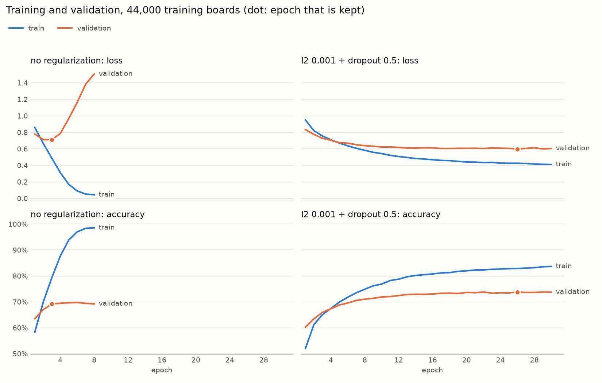
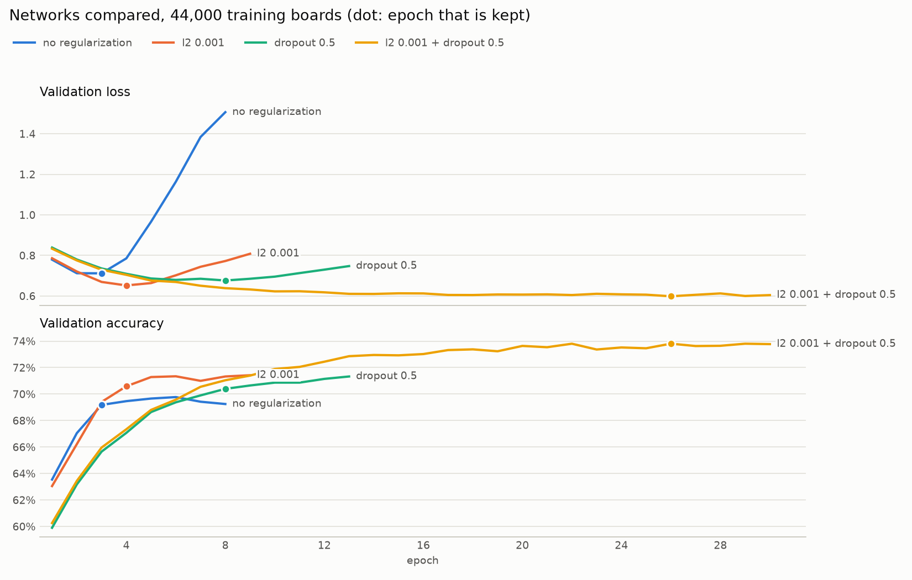
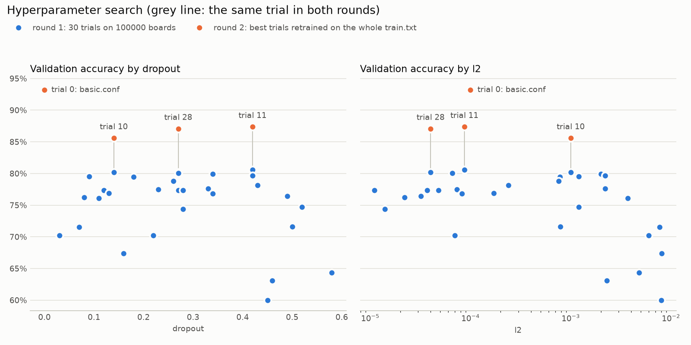
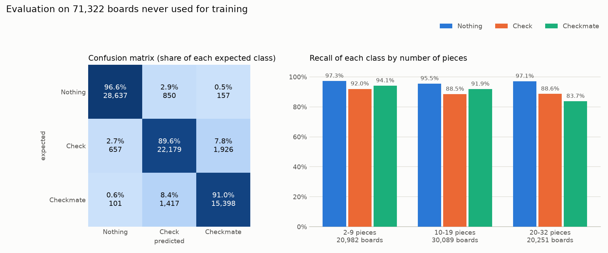

# Benchmarks

All results are measured on the validation split (`dataset/splits/val.txt`, 71,322 boards), built by
`scripts/build_dataset.py` with seed 42. The test split is kept for the final evaluation.

## Class imbalance

The training split (570,574 boards) has more `Nothing` boards than `Checkmate` ones:

| Class | Boards | Share | Class weight |
|---|---|---|---|
| Nothing | 237,154 | 41.6% | 0.802 |
| Check | 198,091 | 34.7% | 0.960 |
| Checkmate | 135,329 | 23.7% | 1.405 |

A class weight multiplies the loss of every board of that class: `boards / (classes × boards of the
class)`, so each class counts as much in the loss as the others, and the mean weight is 1.

The same network was trained twice, without and with these weights:

```sh
scripts/compare_class_weights.py
```

- Configuration: `config/basic.conf` (776 → 256 relu → 64 relu → 3 softmax, Adam, learning rate 0.001,
  batch 64, 30 epochs, seed 42). L2, dropout and early stopping were not implemented yet.
- Both runs start from the same initial weights and see the mini-batches in the same order: the class
  weights are the only difference.

Accuracy per class: the share of the boards of each class that are predicted correctly.

| Training | Overall | Nothing | Check | Checkmate |
|---|---|---|---|---|
| without class weights | **89.58%** | 94.55% | **85.72%** | 86.51% |
| with class weights | 89.49% | 94.56% | 85.16% | **86.93%** |

**Choice: no class weights.**

- Without weights, `Checkmate` is not worse than the other classes: it is recognized as well as `Check`,
  even with 32% fewer boards. With 135,329 examples, the network learns it without help.
- The weights move every class by less than one point, and the overall accuracy goes down by 0.1 point.
- The weakest class is `Check`, and the weights can't help it: its weight is already close to 1.

`class_weights` (in `src/chess/dataset.py`) and the script are kept, to measure again if the dataset or
the classes change.

## Regularization

L2 and dropout keep the network from learning the training boards by heart. The effect is measured on a
small part of the training split, where the network overfits a lot and a run takes a few minutes at most:

```sh
scripts/compare_regularization.py --boards 44000
```

- Configuration: `config/basic.conf` (Adam, learning rate 0.001, batch 64, at most 30 epochs, early
  stopping after 5 epochs without improvement, seed 42). Only `l2` and `dropout` change between the runs.
- Training on the first 44,000 boards of `train.txt`, validation on all of `val.txt`.
- The numbers are those of the network that is kept, the one of the best epoch. The train accuracy is
  measured at the end with every neuron on.

| Regularization | Best epoch | Train | Validation | Gap | Validation loss |
|---|---|---|---|---|---|
| nothing | 3 of 8 | 88.70% | 69.18% | 19.52% | 0.7118 |
| `l2` 0.0001 | 3 of 8 | 87.74% | 69.65% | 18.09% | 0.6908 |
| `l2` 0.001 | 4 of 9 | 86.75% | 70.59% | **16.17%** | 0.6521 |
| `dropout` 0.2 | 4 of 9 | 89.37% | 69.53% | 19.84% | 0.6947 |
| `dropout` 0.5 | 8 of 13 | 91.49% | 70.40% | 21.10% | 0.6765 |
| `l2` 0.0001 + `dropout` 0.2 | 4 of 9 | 88.76% | 69.63% | 19.13% | 0.6809 |
| `l2` 0.001 + `dropout` 0.5 | 26 of 30 | 94.67% | **73.81%** | 20.86% | **0.5985** |

- The strong combination is the best one: 4.63 points more than without regularization, and the lowest
  validation loss. The network keeps improving on the validation boards until epoch 26 instead of 3. Its
  gap stays large because the train accuracy goes up too.
- This run reached the limit of 30 epochs without being stopped, so more epochs could still help it.
- `l2` 0.001 alone gives the smallest gap and 1.41 points more.
- `l2` 0.0001, the value of `config/basic.conf`, changes little: 0.47 point more.

**No value is chosen yet.** These runs use 8% of the training split, so the best values can be different
on the whole split: the hyperparameter search has to measure them again there.

## Learning curves

Loss and accuracy per epoch of four networks of the [Regularization](#regularization) table, with the
same boards and the same settings:

```sh
pip install matplotlib
scripts/learning_curves.py --boards 44000
```

`matplotlib` is only used by this script: the analyzer and the generator don't need it. Without
`--boards`, the script trains on the whole training split.

Early stopping ends each training when it has to, so the curves don't all have the same length. The dot
is the epoch with the lowest validation loss: the network of that epoch is the one that is kept.

### Train and validation



- **Without regularization the network overfits quickly.** From epoch 4 the train loss keeps going down
  (0.04 and 98.57% accuracy at epoch 8), while the validation loss goes up from 0.71 to 1.51 and the
  validation accuracy stays at 69%. Early stopping ends the training at epoch 8 and keeps epoch 3.
- **With `l2` 0.001 and `dropout` 0.5 the validation loss keeps going down** until epoch 26, to 0.60, and
  the train and validation curves stay much closer.
- The train curves are measured during the training, so with dropout some neurons are off. This is why
  the train loss starts above the validation loss, and why the curve is lower than the train accuracy of
  the table, measured at the end with every neuron on (82.88% against 94.67% at epoch 26).

### Several networks



- The epoch that is kept goes from 3 without regularization to 4 with `l2` 0.001, 8 with `dropout` 0.5
  and 26 with both.
- With both, the validation loss doesn't go back up: it is the only network that early stopping doesn't
  stop before epoch 30, and it has the best validation loss and accuracy.

## Hyperparameter search

A random search, in two rounds, chooses the final configuration. Every result is measured on
`val.txt`; the test split stays untouched for the final evaluation.

```sh
scripts/search.py                         # round 1 → docs/search.md
scripts/search.py --retrain 0 11 10 28    # round 2 → docs/search_retrain.md and config/best.conf
scripts/plot_search.py                    # → docs/search.png
```

- **Random search instead of a grid** (Bergstra & Bengio, 2012): with a grid, 30 trials test about 3
  values of each setting; with random draws they test 30. When only one or two settings really matter,
  random search finds good values of them much sooner.
- Each trial draws its hidden layers (`128` to `512-256-64`), `learning_rate` and `l2` (log-uniform, so
  each order of magnitude is as likely), `batch_size` and `dropout`. The rest comes from
  `config/basic.conf` (Adam, He initialization, early stopping after 5 epochs).
- **Reproducible**: `--seed 42` fixes the draws and every trial has its own network seed, so any line of
  the tables can be trained again, and round 2 rebuilds the configurations of round 1 from their numbers.
- **Round 1**: 30 trials on the first 100,000 boards of `train.txt` (20 minutes). **Round 2**: the 3
  best, trained again on the whole `train.txt` with up to 60 epochs, next to **trial 0**:
  `config/basic.conf` as it is, the baseline.



| Trial | Hidden | `learning_rate` | `batch_size` | `dropout` | `l2` | Round 1 (100,000 boards) | Round 2 (whole split) | Val loss |
|---|---|---|---|---|---|---|---|---|
| 0 (`basic.conf`) | 256-64 | 0.001 | 64 | 0 | 0.0001 | not drawn | **93.18%** | **0.1798** |
| 11 | 512-256-64 | 0.0018 | 64 | 0.42 | 0.000087 | 80.60% | 87.37% | 0.3163 |
| 28 | 128 | 0.0023 | 32 | 0.27 | 0.00004 | 80.16% | 87.07% | 0.3363 |
| 10 | 128-32 | 0.00052 | 32 | 0.14 | 0.001 | 80.19% | 85.59% | 0.3691 |

**The best trials of round 1 lose against the baseline by 6 points.** What works on 100,000 boards
doesn't carry over to 570,574:

- With 5.7 times fewer boards the network overfits much more, so round 1 rewards strong regularization:
  every trial of its top 8 has a `dropout` between 0.09 and 0.42. On the whole split there is much
  less overfitting, and this dropout only slows the learning down (left graph).
- `dropout` was drawn between 0 and 0.6, so a network without dropout was almost never tried.
- Too much L2 is clearly bad: the 5 trials of round 1 with `l2` ≥ 0.0048 are all below 72%, among the 7
  worst (right graph).
- L2 itself helps a lot on the whole split: the same network as trial 0 with `l2` 0 (the "nothing"
  configuration of `scripts/compare_regularization.py`, run without `--boards`) stops at epoch 9 and keeps
  epoch 4, with 88.94% and a validation loss of 0.2785. With `l2` 0.0001 it keeps improving until
  epoch 35: 4.24 points more.

**Choice: `config/best.conf`, which is `config/basic.conf` with `epochs` 60.** It has the best validation
accuracy and loss of the search. With 60 epochs instead of 30 it keeps improving until epoch 35, and
early stopping ends it at epoch 40: 93.18%, against 92.88% for the same run limited to 30 epochs.

What the search teaches: the comparison with a baseline is what showed the problem, and the first
round has to run on enough boards to look like the real training. A next search should draw `dropout`
near 0 more often and run its first round on more boards.

## Evaluation on the test set

The final network (`my_torch_network_full.nn`, trained by `scripts/train.sh`) measured on `test.txt`:
71,322 boards that were never used, neither to train nor to choose a setting. `my_torch_network_basic.nn`
has the same weights and gives the same numbers.

```sh
scripts/evaluate.py my_torch_network_full.nn --plot docs/evaluation.png
```

- **Precision** of a class: among the boards the network calls `Check`, the share that really are.
  **Recall**: among the real `Check` boards, the share it finds. **F1** combines both, and **macro-F1**
  is the mean F1 of the 3 classes, so the rarest class (`Checkmate`) counts as much as the others.
- The piece counts are the ones of the dataset files: `10_pieces` has 2 to 9 pieces, `20_pieces` 10 to 19
  and `many_pieces` 20 to 32.



`scripts/evaluate.py my_torch_network_full.nn --chessfile dataset/splits/test.txt`: 71322 boards, accuracy **92.84%**, macro-F1 **0.9223**

| class | boards | precision | recall | F1 |
|---|---|---|---|---|
| Nothing | 29644 | 97.42% | 96.60% | 0.9701 |
| Check | 24762 | 90.73% | 89.57% | 0.9014 |
| Checkmate | 16916 | 88.08% | 91.03% | 0.8953 |

Confusion matrix (rows: expected, columns: predicted):

| expected / predicted | Nothing | Check | Checkmate |
|---|---|---|---|
| Nothing | 28637 | 850 | 157 |
| Check | 657 | 22179 | 1926 |
| Checkmate | 101 | 1417 | 15398 |

Confusion matrix of the full output:

| expected / predicted | Nothing | Check White | Check Black | Checkmate White | Checkmate Black |
|---|---|---|---|---|---|
| Nothing | 28637 | 454 | 396 | 83 | 74 |
| Check White | 333 | 12033 | 0 | 1109 | 0 |
| Check Black | 324 | 0 | 10146 | 0 | 817 |
| Checkmate White | 56 | 812 | 0 | 8331 | 0 |
| Checkmate Black | 45 | 0 | 605 | 0 | 7067 |

By number of pieces:

| pieces | boards | accuracy | macro-F1 | recall Nothing | recall Check | recall Checkmate |
|---|---|---|---|---|---|---|
| 2-9 pieces | 20982 | 94.81% | 0.9421 | 97.26% | 92.00% | 94.12% |
| 10-19 pieces | 30089 | 91.94% | 0.9196 | 95.49% | 88.49% | 91.86% |
| 20-32 pieces | 20251 | 92.12% | 0.8924 | 97.09% | 88.63% | 83.74% |

- **92.84% on the test set, against 93.06% on `val.txt`**: the validation split was used to choose the
  settings, so its score could have been optimistic, but the difference is only 0.22 points.
- **`Nothing` is the easiest class** (F1 0.9701). The network almost never mistakes a quiet board for a
  checkmate, or the other way around: 157 and 101 boards out of 71,322.
- **Most mistakes are between `Check` and `Checkmate`**: 1,926 checks called checkmates and 1,417
  checkmates called checks, two thirds of all the mistakes (3,343 of 5,108). Both have a king in check; telling them apart means
  seeing that no move gets the king out, which is the hardest thing to learn from the pieces alone.
- **The color is never wrong**: in the full matrix, a `White` board is never predicted `Black`. The color
  doesn't come from the network: it is the side that is not to move (see
  [Board encoding](../README.md#board-encoding)), so only the class can be wrong.
- **Crowded boards are the hardest for checkmates**: their recall goes from 94.12% with 2 to 9 pieces to
  83.74% with 20 to 32. With many pieces there are more ways to block or capture, so more checks that
  look like mates; they are also the rarest checkmates of the dataset (28,632 of 173,719).
